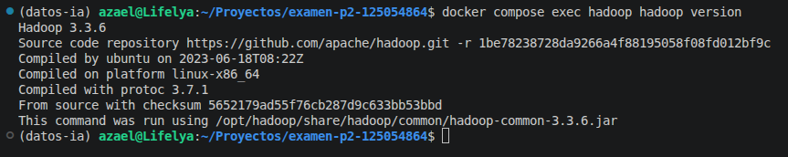
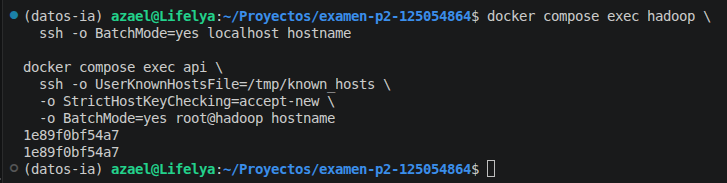
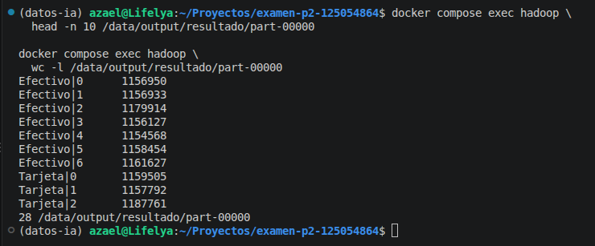
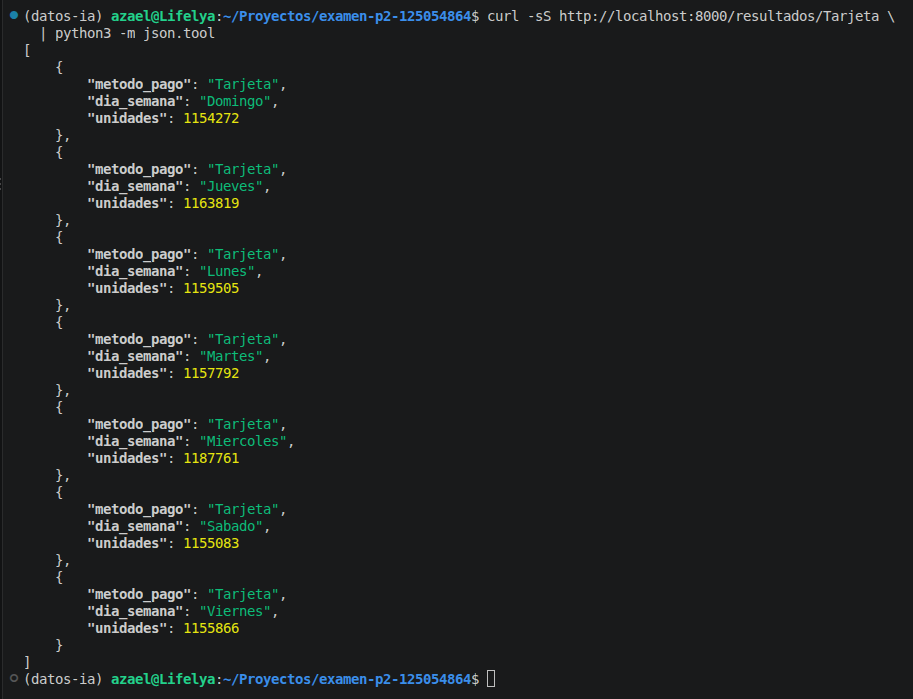

# Examen Segundo Parcial — Pipeline de Datos Contenerizado

**Alumno:** Ian Azael Hernández Silva  
**Matrícula:** 125054864  
**Materia:** Manejo Masivo de Datos (Big Data)  
**Docente:** José Javier Moya Moya  
**Universidad:** Universidad Politécnica de Querétaro

## 1. Descripción

El proyecto implementa un pipeline de procesamiento de datos utilizando Docker, Apache Hadoop MapReduce, PostgreSQL y FastAPI.

Se simula el procesamiento de cinco millones de registros de ventas de una cadena comercial llamada DataMart.

El sistema procesa el dataset, genera resultados agrupados, los almacena en una base de datos y permite consultarlos mediante una API REST.

## 2. Pregunta de negocio

Por terminar mi matrícula en 4, la pregunta asignada es:

**¿Cuántas unidades se vendieron por método de pago y día de la semana?**

Se agrupan los registros por método de pago (Efectivo, Tarjeta, Transferencia y Vales) y día de la semana (lunes a domingo).

La cantidad total se obtiene sumando las unidades de cada venta.

## 3. Tecnologías utilizadas

- Docker Engine y Docker Compose.
- Debian 12.
- Apache Hadoop 3.3.6 en modo standalone.
- Java OpenJDK 17.
- Python 3.11 dentro de los contenedores.
- Python 3.14.4 para procesamiento secuencial en Ubuntu.
- PostgreSQL 16.
- FastAPI y Uvicorn.
- OpenSSH Server.
- Git y GitHub.

## 4. Estructura del proyecto

```text
examen-p2-125054864/
├── README.md
├── TEORIA.md
├── .gitignore
├── .env.example
├── docker-compose.yml
├── hadoop/
│   ├── Dockerfile
│   └── iniciar.sh
├── mapreduce/
│   ├── mapper.py
│   ├── reducer.py
│   └── secuencial.py
├── api/
│   ├── Dockerfile
│   ├── requirements.txt
│   └── app.py
├── scripts/
│   ├── generar_dataset.py
│   └── cargar_resultados.py
├── datos/
│   └── ventas_125054864.csv
└── evidencias/
```

El CSV y el archivo `.env` están excluidos del repositorio por seguridad.

## 5. Instrucciones de reproducción

### Requisitos

Tener instalados Docker Engine, Docker Compose, Python 3 y Git.

### Paso 1. Clonar el repositorio

```bash
git clone https://github.com/nekoscript-exe/examen-p2-125054864.git
cd examen-p2-125054864
```

### Paso 2. Generar el dataset

```bash
mkdir -p datos
cd datos
python3 ../scripts/generar_dataset.py 125054864
cd ..
```

Este procedimiento genera un CSV de aproximadamente 336 MB con 5,000,000 de registros.

### Paso 3. Configurar las variables

```bash
cp .env.example .env
```

Editar `.env` y sustituir `REEMPLAZAR_CON_PASSWORD_SEGURO` por una contraseña segura.

### Paso 4. Construir y levantar los servicios

```bash
docker compose up --build -d
docker compose ps
```

El entorno incluye los servicios `hadoop`, `db` y `api`, conectados mediante la red `datamart_net`.

### Paso 5. Comprobar Hadoop

```bash
docker compose exec hadoop hadoop version
```

### Paso 6. Verificar SSH

Conexión local:

```bash
docker compose exec hadoop \
  ssh -o BatchMode=yes \
  -o StrictHostKeyChecking=accept-new localhost hostname
```

Conexión desde FastAPI:

```bash
docker compose exec api \
  ssh -o UserKnownHostsFile=/tmp/known_hosts \
  -o BatchMode=yes \
  -o StrictHostKeyChecking=accept-new root@hadoop hostname
```

### Paso 7. Ejecutar Hadoop MapReduce

```bash
docker compose exec hadoop /bin/sh -c '
cd /tmp
rm -rf /data/output/resultado
hadoop jar "$HADOOP_HOME"/share/hadoop/tools/lib/hadoop-streaming-*.jar \
  -D mapreduce.framework.name=local \
  -D mapreduce.job.reduces=1 \
  -files /app/mapreduce/mapper.py,/app/mapreduce/reducer.py \
  -input /data/input/ventas_125054864.csv \
  -output /data/output/resultado \
  -mapper "python3 mapper.py" \
  -reducer "python3 reducer.py"
'
```

Consultar la salida:

```bash
docker compose exec hadoop \
  cat /data/output/resultado/part-00000
```

### Paso 8. Cargar los resultados a PostgreSQL

```bash
docker compose exec api \
  python /app/scripts/cargar_resultados.py
```

### Paso 9. Consultar FastAPI

```bash
curl http://localhost:8000/resultados
curl http://localhost:8000/resultados/Tarjeta
```

Documentación interactiva:

http://localhost:8000/docs

## 6. Comparativa de rendimiento

Se ejecutó el mismo procesamiento mediante Hadoop Streaming y Python secuencial.

| Método | Tiempo real |
|---|---:|
| Hadoop MapReduce | 27.515 segundos |
| Python secuencial | 18.348 segundos |

**Resultado:** Python secuencial fue aproximadamente 1.50 veces más rápido.

Ambos métodos produjeron las mismas 28 agrupaciones. La equivalencia se verificó mediante `diff` y `cmp`.

En este escenario, el procesamiento secuencial fue más rápido porque trabaja directamente sobre el archivo, sin la sobrecarga de inicialización, ordenamiento y ejecución de tareas MapReduce. Hadoop se utilizó en modo standalone, por lo que no contó con las ventajas del procesamiento distribuido en múltiples nodos.

## 7. Integración y persistencia

Se cargaron 28 agrupaciones en PostgreSQL.

La API implementa:

- `GET /resultados`
- `GET /resultados/{clave}`
- `POST /resultados`
- `GET /salud`

Se verificó el funcionamiento del endpoint POST utilizando una combinación existente.

Posteriormente se ejecutó:

```bash
docker compose down
docker compose up -d
```

Los resultados se conservaron correctamente gracias al volumen nombrado `postgres_data`.

**Resultado de validación:** PERSISTENCIA EXITOSA: los 28 resultados se conservaron.

## 8. Evidencias

La carpeta `evidencias/` contiene los registros de verificación del proyecto.

| Archivo | Contenido |
|---|---|
| `hadoop-version.txt` | Versión de Hadoop |
| `java-version.txt` | Versión de Java |
| `python-version.txt` | Versión de Python |
| `ssh-localhost.txt` | Conexión SSH local |
| `ssh-api-hadoop.txt` | SSH entre contenedores |
| `mapreduce-ejecucion.txt` | Ejecución Hadoop y tiempo |
| `mapreduce-resultados.txt` | Resultados de MapReduce |
| `secuencial-tiempo.txt` | Tiempo secuencial |
| `secuencial-resultados.txt` | Resultados secuenciales |
| `comparacion.txt` | Validación de equivalencia |
| `carga-postgresql.txt` | Inserción en PostgreSQL |
| `api-resultados.txt` | Consulta GET |
| `api-filtro-tarjeta.txt` | Consulta filtrada |
| `api-post.txt` | Prueba de escritura |
| `persistencia-validacion.txt` | Persistencia confirmada |

### Capturas de ejecución

**Hadoop 3.3.6**



**SSH sin contraseña**



**Resultados de MapReduce**



**Respuesta de FastAPI**



## 9. Respuestas teóricas

Las cinco respuestas de la Parte E se encuentran en [TEORIA.md](TEORIA.md).

## 10. Conclusión

Este proyecto permitió integrar herramientas de contenedorización, procesamiento de datos, bases de datos y desarrollo de APIs.

Durante su implementación surgieron problemas relacionados con la ejecución de scripts, los volúmenes de Docker y Hadoop Streaming, los cuales fueron diagnosticados y corregidos.

La comparación de rendimiento permitió comprobar que Hadoop no necesariamente es más rápido que Python secuencial cuando se utiliza una sola máquina y una agregación sencilla.

Finalmente, se logró procesar el dataset, validar los resultados, almacenarlos y consultarlos mediante una API REST.
